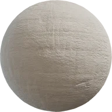
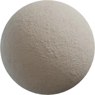
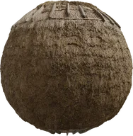
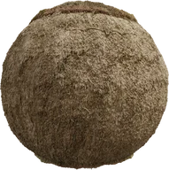
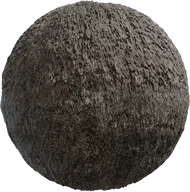
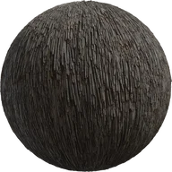

# Poly Haven: Organic textures

**6 assets from [Poly Haven](https://polyhaven.com), dedicated to the public domain under [CC0](https://polyhaven.com/license).** Use them in any game, free or paid, and change them however you like; no credit is needed.

PBR textures as 1K and 2K JPG maps (colour, normal (GL and DX), roughness, AO, displacement and more). 159.5 MB in all.

This is a copy kept by [zuujis-cc0](https://github.com/zuujis-cc0) so game makers can take single files from GitHub. It is not made by or affiliated with Poly Haven: the originals, often in more formats and higher resolutions, are on [polyhaven.com](https://polyhaven.com). If they help you, consider [supporting Poly Haven](https://www.patreon.com/polyhaven/overview).

Every file is listed in [MANIFEST.tsv](MANIFEST.tsv) with its size and SHA-256. More free assets: [the Zuujis collection](https://github.com/zuujis-cc0/free-game-assets#readme).

| | | | |
| :-: | :-: | :-: | :-: |
|  <b><a href="flour">Flour</a></b> by Jenelle van Heerden · <a href="https://polyhaven.com/a/flour">source</a> |  <b><a href="macro_flour">Macro Flour</a></b> by Dario Barresi, Jenelle van Heerden · <a href="https://polyhaven.com/a/macro_flour">source</a> |  <b><a href="reed_roof_03">Reed Roof 03</a></b> by Rob Tuytel · <a href="https://polyhaven.com/a/reed_roof_03">source</a> |  <b><a href="reed_roof_04">Reed Roof 04</a></b> by Rob Tuytel · <a href="https://polyhaven.com/a/reed_roof_04">source</a> |
|  <b><a href="riet_01">Riet 01</a></b> by Rob Tuytel · <a href="https://polyhaven.com/a/riet_01">source</a> |  <b><a href="thatch_roof_angled">Thatch Roof Angled</a></b> by Dimitrios Savva, Rob Tuytel · <a href="https://polyhaven.com/a/thatch_roof_angled">source</a> |  |  |

---

Kept up to date by this repository's own [update workflow](.github/workflows/update.yml), with code and plan from [cc0-mirror](https://github.com/zuujis-cc0/cc0-mirror). Something wrong? [Open an issue there](https://github.com/zuujis-cc0/cc0-mirror/issues/new) or use the [private report form](https://games.zuujis.com/report).
